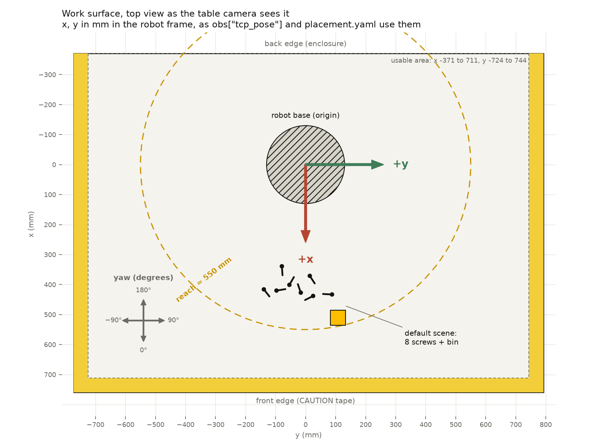

# Client package: PhysicalAI-Hackathon-2026

> **Our notes (not part of the source):**
>
> - **Where this came from:** linked from the participant dashboard ([06](../06-participant-dashboard.md)) as the
>   client package. On 2026-10-20 Claude downloaded the public repo's files from GitHub (`raw.githubusercontent.com`,
>   branch `main`, commit `ff7534e730f2b3db261c7f22d3d9b56a40c00eed`, "README: we keep adding slots", 2026-10-19). Below
>   are the README, the two submission templates and `calibration/FRAMES.md`. The code isn't vendored. Clone the repo
>   to run it; our `policy.py` and submission files go into that clone ([../../cell_policy/](../../cell_policy/README.md)).
>   License: Apache-2.0.
> - **A run is 10 rollouts by default.** The operator scores each one success or failure. Our printed fingers go under
>   `custom_hardware`, and the organizers review them with the request.
> - `placement.yaml` can give each rollout its own `prompt`, which reaches the policy as `obs["trial"]["instruction"]`.
>   Our policy reads each rollout's test-plan offset from it, so the recordings carry the offset too.
> - The client says it runs on Linux and macOS. `mock_cell.py`'s TCP limits are x 150–650, y −450–450, z −334–300 mm in
>   UF0, and `act` returns 1 to 100 rows with `dt` from 0.1 to 1.0 s.

[Website](https://hackathon.sidclab.org) · [Track 3](https://uwm.edu/csi/nvidia-rockwell-hackathon-fall-2026/) ·
License: Apache-2.0

An online platform for standardized submission, remote execution, and reproducible evaluation of robot policies on
physical robots.

You develop your policy your own way, for example in Isaac Sim with our starter and your own data. We then evaluate it on
our real robot, a FANUC ER-4iA: our server sends your machine an observation (`obs`), your policy returns the next action,
`act(obs)`, and this repeats until the rollout ends. Your policy runs on your machine; the cell plays the actions you
return and enforces every safety limit.

| Path | What it is |
| --- | --- |
| `policy.py` | **Your policy.** Edit this file. |
| `run.py` | Checks your policy on the mock, submits, and runs it on the cell. |
| `mock_cell.py` | A local stand-in for the cell, with the same API and limits (`run.py --mock` starts it). |
| `submission/submission.yaml` | Your team, model and task. |
| `submission/placement.yaml` | Where the objects go in each rollout, and its prompt (only if they change). `table_plan.png` shows the table and the axes. |
| `calibration/` | Optional: the real cameras' calibration (the starter's sim cameras already use it), for code that maps pixels or depth to robot coordinates. |
| `cell_client.py` | The client library. Do not edit it. |

A **run** is one approved submission: **10 rollouts** by default. A **rollout** is one attempt at your task, scored success
or failure; faults and interventions are noted.

## 1. Get the client package

Install [uv](https://docs.astral.sh/uv/), then:

```bash
git clone https://github.com/SIDCLab/PhysicalAI-Hackathon-2026 && cd PhysicalAI-Hackathon-2026
uv sync
```

`uv sync` installs numpy, OpenCV and requests; add what your policy needs with `uv add` (e.g. `uv add torch`).

## 2. Wrap your sim model

Wrap the model you trained in simulation in `policy.py`: load it in `__init__`, and implement `act(obs)`, which receives
the robot's observation and returns the next action. After the action finishes, `act(obs)` is called again.
(`uv run run.py --checkpoint <path>` passes a path to `__init__`, if you prefer that to a path in `policy.py`.)

**Observation**

| | |
| --- | --- |
| `obs["images"]` | RGB images from the cameras you list in `CAMERAS` (table, side and/or wrist) |
| `obs["joints"]` | the robot's joint angles J1–J6 in degrees, and the gripper state (0 = open, 1 = closed) |
| `obs["tcp_pose"]` | the fingertip position and orientation `[x, y, z, w, p, r]`: position in mm, orientation in degrees |
| `obs["trial"]` | the current rollout, including the task instruction (your policy may ignore it) |
| `obs["depth"]` | only with `DEPTH = ["table"]`, `["wrist"]` or both in `policy.py`: uint16 images in mm along each camera's axis (0 = no depth), table 640 x 400, wrist 848 x 480. `calibration.geometry.depth_to_base` turns them into base-frame points (the wrist also needs `joints=obs["joints"]`). Not recorded |

**Action.** Choose one format with `ACTION` in `policy.py`:

- `ACTION = "joints"`: `[J1, J2, J3, J4, J5, J6, gripper]`. Move the robot with joint angles, in degrees (the v0.5 twin's
  convention). Recommended for learned robot policies.
- `ACTION = "tcp"`: `[x, y, z, w, p, r, gripper]`. Move the fingertip to a target position and orientation; the robot
  works out the joints. Recommended for planners and AI agents. e.g. fingers pointing straight down: `w, p, r = -180, 0, R`.

If your machine is far from the cell, set `IMAGE_FORMAT = "jpeg"`. If `act` returns many actions at once (an action chunk,
such as ACT's), set `PREFETCH = True`: the next actions are planned while these still play, so the arm does not stop
between them. It helps when one call returns more than twice the time it takes.

## 3. Check formats and connection

```bash
uv run run.py --mock
```

Runs your policy against a stand-in for the cell on your machine, with no robot. It ends with **✓ Ready for the real
robot**, or **✗ Not ready** with what to fix (an action the robot would reject, or an error in `act`) and where it first
happened. The mock's images are synthetic, so your policy may not do anything useful there; it only checks that your policy
and the cell understand each other.

## 4. Describe your task and submit

Fill in `submission/submission.yaml` (each field has a comment), and `submission/placement.yaml` unless your task uses our
default scene (8 screws and the yellow bin, the same every rollout), then send it:

```bash
uv run run.py --submit
```

Then pick a 30-minute slot in the **Calendar** tab of [hackathon.sidclab.org](https://hackathon.sidclab.org/#calendar) with
the request id it prints, such as `q3ac71f`; we approve your request for that slot. We keep adding available slots. In
`placement.yaml`, list where each object goes and optionally a `prompt`, the instruction your policy gets in
`obs["trial"]["instruction"]`: one entry for a scene that stays the same, or one entry per rollout if objects or layout are
`different`. Send none and keep both `same`, and every rollout gets the default scene.

`--submit` also saves `.request.json`: keep that file, and keep it private (your client needs it, and it holds the secret
for your request). We review the request and approve it, or reject it with a reason. Check where it stands:

```bash
uv run run.py --status
```

## 5. Run during your slot

Once we approve your request, your client picks up its token by itself and waits for the operator. Start it and leave it
running:

```bash
uv run run.py
```

For each rollout, the operator homes the arm, sets up the objects as your submission says, and starts it; your policy then
runs until the operator scores the rollout, stops it, or the controller faults, and the next one begins. You do nothing
between rollouts. Come to the lab to watch if you can; every rollout is recorded either way.

Every rollout is recorded and appears with its score and videos under **My results** on
[hackathon.sidclab.org](https://hackathon.sidclab.org). Only your team sees them: open the link that
`uv run run.py --status` prints (`https://hackathon.sidclab.org/#key=...`); your browser remembers it.

To work with the data yourself, download your run's recorded LeRobotDataset (every recorded rollout so far; the link
**download dataset** under My results gives the same file):

```bash
uv run run.py --download
```

It goes to LeRobot's default dataset folder. Run it again after more rollouts to get the latest.

## Recording

Every rollout is recorded: the three cameras and the robot state, 10 times a second. The videos appear under My results
next to your scores, and on the leaderboard once it opens at the end of the event. Tell us when you book if your runs
should stay off it.

---

Organizers: UW-Milwaukee Connected Systems Institute and Milwaukee School of Engineering. Partners: NVIDIA and Rockwell
Automation. Platform developer: SIDC Lab, UW-Milwaukee.

## Appendix: `submission/submission.yaml` (template, as in the repo)

```yaml
# Your submission. Run: uv run run.py --submit

team: <team name>
contact: <name, email>
policy: <policy name>             # Give your policy a name (e.g., GraspV1)

# Choose the closest model type. This does not affect scoring.
model_type: Hybrid
# VA          Images -> actions (ACT, Diffusion Policy)
# VLA         Images + instructions -> actions (NVIDIA GR00T)
# WAM         Predicts future states to guide robot actions
# VLM + BM    A VLM decides what to do; a behavior model executes actions
# TAMP + FMs  Foundation models assist task and motion planning
# Hybrid      Combines multiple approaches, or choose this if unsure

# --- Task ---
task_id: pick-cube-C              # Short task name ending with your team letter
task: Put the cube into the yellow bin.
                                  # Describe your task in one short sentence

# --- Test Setup ---
# Tell us how to prepare the workspace for each rollout.
# Objects and layout can stay the same or change between rollouts.

objects: same
# same: Use the same set of objects for every rollout.
# different: May use different objects across rollouts.

layout: same
# same: Place objects in the same positions for every rollout.
# different: May change object positions across rollouts.

# --- Evaluation ---
rollouts: 10                      # Number of attempts in this test
                                  # Each attempt is scored success or failure

# --- Hardware ---
custom_hardware: none            # Describe any hardware changes (e.g., 3D-printed fingers)
```

## Appendix: `submission/placement.yaml` (template, as in the repo)

```yaml
# Where the objects go in each rollout, and what your policy is told. Sent with: uv run run.py --submit
#
# Leave it empty only if your task uses our default scene: 8 screws and the yellow bin (as in the twin), the same
# every rollout. For any other objects or layout, fill it in:
#   - objects and layout "same" in submission.yaml: one entry, used for every rollout;
#   - objects or layout "different": one entry per rollout, as many as "rollouts" (10 by default).
# Positions: x, y in mm in the robot frame (the same x, y as obs["tcp_pose"]), and an optional yaw in degrees;
# table_plan.png shows the axes and the table. A screw's position is its head, and its yaw points to its tip.
# Several objects of one kind: a list of positions, e.g. screw: [[420, -100, 30], [380, 50, 90]]
#
# rollouts:
#   - objects:                                     # rollout 1
#       cube: [420, -100, 30]
#       bin: [510, 110]
#     prompt: Put the cube into the yellow bin.    # optional; default: task in submission.yaml
#   - objects:                                     # rollout 2
#       cube: [380, 50, 90]
#       bin: [480, -150]
#   ...                                            # up to rollout 10

rollouts: []
```

`submission/table_plan.png` ("Work surface, top view as the table camera sees it"; x, y in mm in the robot frame; usable
area x −371 to 711, y −724 to 744; reach about 550 mm; yaw 0° along +x, 90° along +y; the default scene's 8 screws and
bin):



## Appendix: `calibration/FRAMES.md`

| Frame | Definition |
| --- | --- |
| Robot base | x forward, y left, z up, metres. The work surface is at z = −0.0051 m. The twin's scenes, task cards and the camera calibration use this frame. |
| UF0 | The controller user frame used by `obs["tcp_pose"]` and by `"tcp"` actions, in millimetres. x and y equal the base frame's; z_UF0 = z_base − 330 mm, so the surface is at about −335 mm. |
| UTOOL1 (the TCP) | The fingertip: 223 mm past the flange face, which is 70 mm past the wrist centre, so 293 mm from the J6 origin. `w, p, r = −180, 0, R` points the fingers straight down, and R turns them about z. |
| Joints | J1–J6 in degrees, in the twin's convention: J3 is measured relative to the upper arm (`sim J3 = controller J3 + J2`). The gripper is 0 (open) or 1 (closed). |

`cameras.json` holds the real cameras, solved with ArUco plates on the cell:

| Camera | Size | Transform | Notes |
| --- | --- | --- | --- |
| table | 1920×1080 | `T_base_cam` | Fixed, overhead from the front. |
| side | 1920×1080 | `T_base_cam` | Fixed. Re-aimed and re-solved after the testbed rebuild. |
| table_depth | 640×400 | `T_base_cam` | The table camera's depth stream (`DEPTH = ["table"]`): pinhole with its own `fx, fy, cx, cy` and no distortion; values in mm along the optical axis. `depth_to_base` in `geometry.py` turns a depth image into base-frame points. Factory intrinsics and depth-to-colour extrinsics on the table colour camera's pose, levelled on the work surface (`rms_plane_mm`). |
| wrist_depth | 848×480 | `T_flange_cam` (J6_link) | The wrist camera's depth stream (`DEPTH = ["wrist"]`), the same view as the wrist colour image: pinhole with its own `fx, fy, cx, cy`, no distortion, mm along the optical axis. It moves with the arm: `depth_to_base(cams["wrist_depth"], depth, joints=obs["joints"])` (`flange_pose` in `geometry.py` is the arm's FK). Factory intrinsics on the wrist colour camera's flange pose, levelled on the work surface at `solved_at_joints`. |
| wrist | 1280×720 | `T_flange_cam` (J6_link) | Captured at 848×480 at 15 fps over USB 2.0, with the same field of view, and served at whatever size you request. |

The projection model and its inverse are in `geometry.py` (numpy only). Use `pixel_to_base` to map a table-image pixel to
a point on the table. These transforms match the twin's camera poses up to the residual errors in `rms_px`, so pixels in
the v0.5 twin and on the real cell line up.
